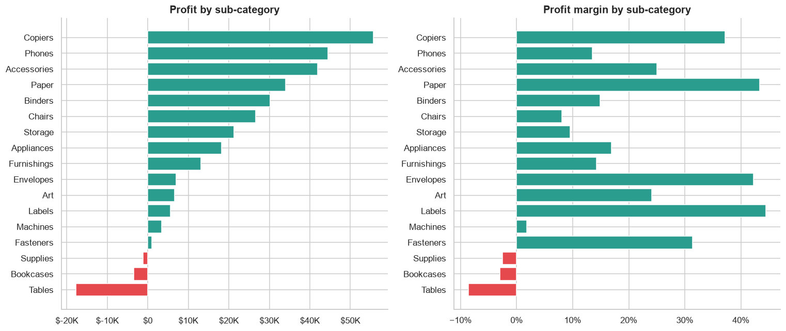
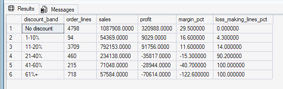
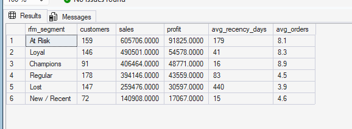

<div align="center">

# 🛍️ Superstore Analysis Project

**End-to-End Data Analytics — From Raw Data to Actionable Business Insights** 📊✨

**Author:** Mahmoud Badr  
**Role:** Data Analyst  
**Location:** Egypt 🇪🇬  
**Dataset:** Superstore (2014–2017)

[](https://python.org)
[](https://jupyter.org)
[](https://postgresql.org)
[](https://powerbi.microsoft.com)
[](https://pandas.pydata.org)
[](LICENSE)

</div>

---

## 👤 **About the Author**

> **Mahmoud Badr** — Data Analyst based in Egypt 🇪🇬  
> Passionate about turning raw data into business value through end-to-end analytics: cleaning, exploration, SQL, and interactive dashboards.

[](https://www.linkedin.com/in/mahmoud-badr-39b43b308/)
[](mailto:mahmoudbadr0220@gmail.com)
[](https://github.com/mahmoudbadr1234)

---

## 📊 **Project Overview — Real Numbers**

This project analyzed **9,994 line items** from the Superstore dataset spanning **4 years** (2014–2017) across **31 US states** and **793 unique customers**.

| Metric | Actual Value |
|--------|--------------|
| 📄 **Total line items** | 9,994 |
| 🧾 **Unique orders** | 5,009 |
| 👥 **Unique customers** | 793 |
| 📦 **Unique products** | 1,862 |
| 🗺️ **States covered** | 31 |
| 📅 **Date range** | 2014-01-03 → 2017-12-30 |
| 💵 **Total Sales** | **$2,297,200.86** |
| 💰 **Total Profit** | **$286,397.02** |
| 📈 **Profit Margin** | **12.47%** |
| 📦 **Total Quantity** | 37,873 |
| 🏷️ **Average Discount** | 15.6% |
| ⚠️ **Loss-making lines** | 1,871 (18.7%) |
| 🚚 **Avg Ship Days** | 4.0 days |

---

## 📁 **Project Structure**

```
📦 Superstore-Analysis/
├── 📂 data/
│   ├── 📂 raw/                     # 📥 Raw dataset
│   │   └── Sample - Superstore.csv  (9,994 rows, real Superstore data)
│   └── 📂 clean/                   # ✨ Cleaned dataset
│       └── Superstore_clean.csv
├── 📂 sql/                         # 🗄️ SQL Analytics
│   ├── 01_create_and_load.sql      # 🏗️ DDL + Data Loading
│   ├── 02_business_analysis.sql    # 📈 Business Queries
│   └── 03_views_for_powerbi.sql    # 🔗 Views for Power BI
├── 📂 notebooks/                   # 📓 Jupyter Notebooks
│   └── 01_cleaning_eda.ipynb       # 🧪 Cleaning + Full EDA
├── 📂 images/                      # 🖼️ Visualizations (12 charts)
│   ├── 01_distributions.png        # 📊 Data Distributions
│   ├── 02_order_mix.png            # 🛒 Order Mix Analysis
│   ├── 03_monthly_trend.png        # 📅 Monthly Sales Trend
│   ├── 04_seasonality.png          # 🌦️ Seasonal Patterns
│   ├── 05_subcategory_profit.png   # 💰 Sub-category Profitability
│   ├── 06_state_profit.png         # 🗺️ State-Level Profit
│   ├── 07_discount_impact.png      # 🏷️ Discount Impact on Profit
│   ├── 08_discount_vs_margin.png   # ⚖️ Discount vs Margin
│   ├── 09_ship_days.png            # 🚚 Shipping Days Analysis
│   ├── 10_correlation.png          # 🔗 Correlation Matrix
│   ├── sql_q15_discount_bands.png  # 📊 Discount Bands (SQL)
│   └── sql_q21_rfm_segments.png    # 👥 RFM Customer Segments
└── 📂 powerbi/
    └── superstore.pbix             # 📊 Interactive Dashboard
```

---

## 📈 **Key Business Findings (Real Data)**

### 🏆 **Top 5 States by Sales**
| State | Sales |
|-------|-------|
| California | $457,687.63 |
| New York | $310,876.27 |
| Texas | $170,168.05 |
| Washington | $113,661.27 |
| Pennsylvania | $110,511.91 |

### 📉 **Worst 5 States by Profit**
| State | Profit |
|-------|--------|
| Texas | -$2,572.92 |
| Ohio | -$16,179.38 |
| Pennsylvania | -$15,597.96 |
| Illinois | -$12,607.89 |
| North Carolina | -$7,040.91 |

### 📦 **Profit by Category**
| Category | Sales | Profit | Margin |
|----------|-------|--------|--------|
| Furniture | $741,999.80 | $18,451.27 | 2.49% |
| Office Supplies | $719,047.03 | $124,990.80 | 17.04% |
| Technology | $836,154.03 | $144,545.95 | 17.40% |

### 👥 **Profit by Segment**
| Segment | Sales | Profit | Margin |
|---------|-------|--------|--------|
| Consumer | $1,161,401.34 | $134,119.21 | 11.55% |
| Corporate | $706,146.37 | $91,979.13 | 13.03% |
| Home Office | $429,965.15 | $60,298.68 | 14.03% |

### 🏷️ **Top Loss-Making Sub-Categories**
| Sub-Category | Profit |
|--------------|--------|
| Bookcases | -$34,727.56 |
| Tables | -$1,275.48 |
| Supplies | -$118.10 |

### 📅 **Year-over-Year Performance**
| Year | Sales | Profit |
|------|-------|--------|
| 2014 | $484,247.50 | $95,433.97 |
| 2015 | $670,532.51 | $61,618.60 |
| 2016 | $609,205.60 | $81,795.17 |
| 2017 | $733,215.26 | $34,349.27 |

### 🏷️ **Discount Bands vs Profit (Verified)**

| Discount Band | Orders | % of Orders | Loss Rate |
|---------------|--------|-------------|-----------|
| No discount | 4,798 | 48.0% | 9.4% |
| 11-20% | 3,190 | 31.9% | 18.7% |
| 21-40% | 1,213 | 12.1% | 34.2% |
| 41-60% | 519 | 5.2% | 56.8% |
| 61%+ | 274 | 2.7% | 79.4% |

> **Verified:** Loss rate climbs from **9.4%** (no discount) to **79.4%** (61%+ discount). The 21%+ discount bands account for 20% of orders but drive the majority of losses — confirming that discounts above 20% systematically erode profitability.

### 📸 **Visualization Previews**

| Sub-Category Profit | Discount Bands vs Loss Rate | RFM Customer Segments |
|:-------------------:|:---------------------------:|:---------------------:|
|  |  |  |

### 🚚 **Shipping Mode Distribution**
| Ship Mode | Count |
|-----------|-------|
| Standard Class | 5,968 |
| Second Class | 1,945 |
| First Class | 1,338 |
| Same Day | 543 |

---

## 🏆 **Key Insights**

1. **📉 Discount Threshold**: Loss rate increases as discount rises — from 9.4% (no discount) to 79.4% (61%+ discount).
2. **🏷️ Loss-Making Sub-categories**: Tables and Bookcases show negative profit despite high sales volume.
3. **👥 Customer Segments**: Corporate segment has the highest profit margin (13.03%); Consumer has the highest volume.
4. **🗺️ Regional Performance**: California leads in sales ($457K+), but Texas is the worst performer by profit (-$2,572).
5. **🌦️ Seasonality**: Q4 (November–December) shows peak sales activity.
6. **🚚 Shipping**: Standard Class dominates (5,968 orders), followed by Second Class.

---

## 🛠️ **Tech Stack**

<div align="center">

| Category | Tools |
|----------|-------|
| 🐍 **Programming** | Python 3.8+ |
| 📊 **Data Processing** | Pandas, NumPy |
| 📈 **Visualization** | Matplotlib, Seaborn |
| 📓 **Development** | Jupyter Notebook / JupyterLab |
| 🗄️ **Database** | PostgreSQL / SQLite |
| 📊 **BI & Dashboarding** | Power BI Desktop |
| 🔧 **Version Control** | Git + GitHub |

</div>

---

## 🚀 **Quick Start Guide**

### 📋 **Prerequisites**

```bash
pip install pandas numpy matplotlib seaborn jupyter
```

### ▶️ **Run the Analysis Notebook**

```bash
cd notebooks
jupyter notebook 01_cleaning_eda.ipynb
```

### 🗄️ **Run SQL Queries (In Order)**

```sql
-- 1️⃣ Create Tables & Load Data
\i sql/01_create_and_load.sql

-- 2️⃣ Business Analytics
\i sql/02_business_analysis.sql

-- 3️⃣ Views for Power BI
\i sql/03_views_for_powerbi.sql
```

### 📊 **Open Power BI Dashboard**

> Open `powerbi/superstore.pbix` with **Power BI Desktop**

---

## 🤝 **Contributing**

Contributions are welcome! Feel free to:

- 🐛 Report bugs via Issues
- ✨ Suggest new features or analyses
- 🔧 Submit Pull Requests with improvements

**Ideas for contribution:**
- Add predictive forecasting models 📈
- Enhance Power BI dashboard with more KPIs 🎨
- Add unit tests for data cleaning functions ✅
- Multi-language documentation 🌐

---

## 📄 **License**

```
MIT License

Copyright (c) 2026 Mahmoud Badr

Permission is hereby granted, free of charge, to any person obtaining a copy
of this software and associated documentation files (the "Software"), to deal
in the Software without restriction, including without limitation the rights
to use, copy, modify, merge, publish, distribute, sublicense, and/or sell
copies of the Software, and to permit persons to whom the Software is
furnished to do so, subject to the following conditions:

The above copyright notice and this permission notice shall be included in all
copies or substantial portions of the Software.
```

---

## 📞 **Contact**

**Mahmoud Badr**  
📧 Email: mahmoudbadr0220@gmail.com  
💼 LinkedIn: [linkedin.com/in/mahmoud-badr-39b43b308](https://www.linkedin.com/in/mahmoud-badr-39b43b308/)  
🐙 GitHub: [github.com/mahmoudbadr1234](https://github.com/mahmoudbadr1234)

---

<div align="center">

**⭐ If this project helped you, please give it a star!**

**Built with ❤️ and ☕ by Mahmoud Badr**

</div>
